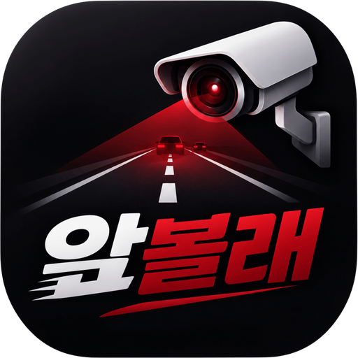
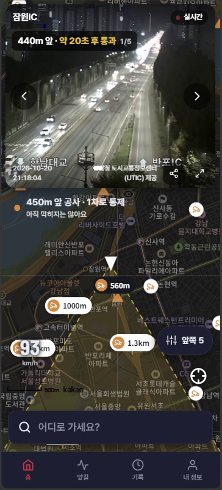
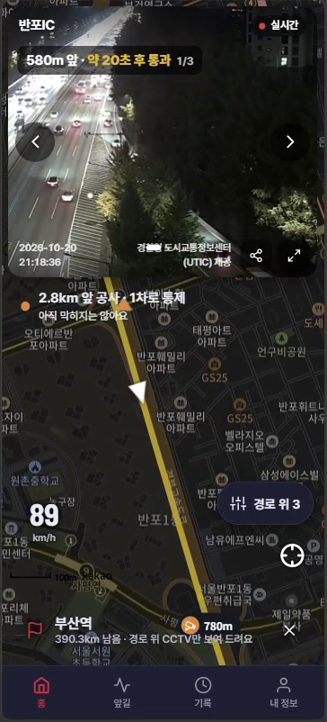
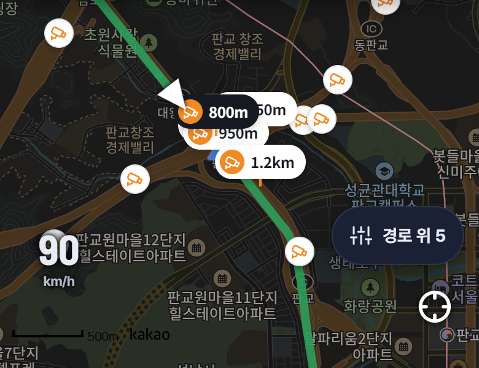

<p align="center">
  
</p>

<h1 align="center">앞볼래 (Apbollae)</h1>
<p align="center"><b>차가 막힐 때, 조수석에서 보는 내 앞 도로 CCTV</b><br/>팀 졸업하자</p>

<p align="center">
  
  &nbsp;&nbsp;
  
</p>

> 이 문서는 프로젝트 차터(Project Charter v2.0, 2026-10-26)를 옮긴 것입니다. 원본과 다른 산출물은 [`docs/`](docs/)에 있습니다.

---

## 1. 프로젝트 개요
| 항목 | 내용 |
|---|---|
| 프로젝트 명 | 앞볼래 (Apbollae) |
| 조 명 | 졸업하자 |
| 한 줄 소개 | 현재 위치와 진행 방향을 기준으로 **"지금 내 앞"** 도로 CCTV만 골라 가까운 순으로 자동 재생하는 조수석 동승자용 앱 |
| 최종 발표 | 2026-12-09 |

## 2. 배경 및 문제 정의
- 차가 막힐 때 내비게이션(티맵 등)은 도로를 빨간 막힘 표시로만 보여 줍니다. 사고인지, 공사인지, 단순히 차가 많은 건지는 알 수 없습니다.
- 기존 지도 앱에도 CCTV 보기 기능은 있습니다. 하지만 ① 지도를 확대하고 ② CCTV 아이콘을 찾아 누른 뒤 ③ 상·하행과 내 경로 위인지를 직접 판단해야 해서, 정작 답답한 순간에는 쓰기 어렵습니다.
- 도로 CCTV 영상과 돌발상황(사고·공사·통제) 정보는 ITS 국가교통정보센터와 UTIC 경찰청 도시교통정보센터가 무료로 공개합니다. 다만 이를 "지금 내 앞" 기준으로 묶어 주는 서비스는 없습니다.

> **핵심 문제:** 전방 상황을 보여 줄 CCTV는 이미 있는데, "지금 내 앞" 기준으로 골라 주지 않아 필요한 순간에 쓸 수 없습니다.

## 3. 프로젝트 목적
1. 현재 위치와 진행 방향(목적지가 있으면 가는 경로)을 기준으로 **내 앞 CCTV만 골라 가까운 순으로 자동 재생**합니다. 다음 CCTV까지의 거리와 통과 시점도 알려 줍니다(예: "580m 앞 · 약 20초 후 통과").
2. 앞길 한 줄 요약(예: "2.8km 앞 공사 · 1차로 통제")과 길 색(초록 원활·노랑 서행·빨강 정체)을 함께 보여 줘, **막힌 이유와 범위를 바로 확인**하게 합니다.
3. **조수석 동승자 전용**으로 설계했습니다. 동승자 확인을 거친 뒤에만 영상을 재생해, 운전 중 영상 시청을 막습니다.

## 4. 프로젝트 목표 및 성공 기준
| 목표 | 성공 기준 |
|---|---|
| 전방 CCTV 자동 선별 | 실제 주행(12~13주) 20곳에서 고른 CCTV가 진짜 내 앞인 비율 90% 이상 |
| 조작 없는 확인 | 앱 실행 후 첫 영상 재생까지 5초 이내, 추가 조작 없이 가장 가까운 CCTV 자동 재생 |
| 가까운 순 한 화면 표시 | 목적지가 없으면 진행 방향 ±30°·5km 부채꼴(반대 차로 제외), 달리는 도로를 알면 그 도로 앞 6km, 목적지가 있으면 경로 위 CCTV만 최대 5개. 30초 또는 500m 이동마다 자동 갱신 |
| 정체 원인·막힘 정도 표시 | 앞길 한 줄 요약과 CCTV 카드 배지로 사고·공사·통제 표시, 길 색으로 막힘 정도 표시 |
| 목적지 경로 고르기 | 경로별 CCTV 수와 막힌 구간을 비교해 고를 수 있게 제공 |
| 동승자 안전 장치 | 동승자 확인 전 영상 재생 0회, 운전자용 기능(음성 안내·자동 팝업) 미제공 |
| 기존 앱 대비 편의성 | 사용성 테스트(10명)에서 확인 시간 50% 이상 단축, SUS 70점 이상 |
| AI 판별 (9~10주) | CCTV 속 차를 찾아 정체·서행·원활을 판별하는 정확도 80% 이상 |

## 5. 주요 사용자
- **1차 사용자:** 정체 구간에서 조수석에 앉은 동승자(가족·친구·연인·카풀). 운전자 대신 "왜 막히는지"를 확인해 알려 주는 사람입니다.
- **1차 이용 상황:** 명절·주말 고속도로 장거리 이동, 출퇴근길 상습 정체 구간, 우회 여부를 판단해야 하는 순간
- **2차 사용자:** 택시·화물차 동승자, 단체 이동 인솔자 등 경로 판단을 돕는 동행자

## 6. 프로젝트 범위
| In-Scope | Out-of-Scope |
|---|---|
| GPS 위치·진행 방향 확인, "내 앞" CCTV 선별(부채꼴·달리는 도로·경로 위) | 턴바이턴 길안내(내비게이션) |
| ITS(고속도로·국도)·UTIC(서울 도시) CCTV 실시간 자동 재생, 크게 보며 넘기기 | CCTV를 피해 가는 경로 재탐색(선행 특허 KR102430774의 핵심 기능이라 넣지 않음) |
| 통과 예상 시간, 앞길 한 줄 요약(사고·공사 등 돌발 정보) | 정체 해소 시각 예측(AI 예측 모델) |
| 길 색으로 막힘 정도 표시, 목적지 경로 위 CCTV와 경로 비교 | 민간 CCTV·블랙박스 영상 수집 및 공유 |
| 동승자 확인, 선택 로그인, 기록 탭, 날씨·노면, 밤 모드, 오픈소스 라이선스 화면 | CCTV 영상 녹화·재배포, CCTV 목록 크롤링 |
| 우리 서버(API 키 숨김·데이터 저장·재사용), AI 차 검출(우리 차 찾기·앞길 자동 기록) | 차량 화면(CarPlay·Android Auto) 연동, 결제 등 수익화 |

<p align="center"></p>

## 7. 주요 요구사항
| ID | 요구사항 | 중요도 | 활용 OSS |
|---|---|:-:|---|
| FR-02·03 | 현재 위치·진행 방향·속도를 받습니다. 위치는 서버에 저장하지 않고 휴대폰 안에서 "내 앞"을 판단합니다. | 상 | React Native |
| FR-04·09 | 목적지가 없으면 진행 방향 ±30°·5km 부채꼴 안에서 반대 차로를 빼고 고릅니다. 달리는 도로를 알면 그 도로 앞 6km만 고릅니다. | 상 | Turf.js, pyshp·pyproj |
| FR-10 | 목적지가 있으면 경로 위 CCTV만 가까운 순으로 고르고, 경로별 CCTV 수·막힌 구간을 비교하게 합니다. | 상 | Turf.js |
| FR-05·06·18 | 고른 CCTV를 가까운 순으로 최대 5개 보여 주고 1순위를 자동 재생합니다. 재생이 안 되면 다음 CCTV로 넘어갑니다. | 상 | hls.js |
| FR-17 | 다음 CCTV까지 거리와 통과 예상 시간을 보여 줍니다. 30초 또는 500m마다 다시 고르고, 지나친 CCTV는 뺍니다. | 상 | Turf.js |
| FR-07·08·11 | 앞길 돌발상황을 한 줄로 요약하고 CCTV 카드에 배지로 붙입니다. 길 색으로 막힘 정도를 보여 줍니다. | 상 | - |
| FR-01 | "저는 조수석 동승자입니다" 확인을 받고, 확인 전에는 영상을 재생하지 않습니다. | 상 | - |
| FR-12·19 | API 키는 서버에만 두고 받은 데이터를 저장·재사용합니다(ITS 월 1,000건 한도). UTIC 영상 주소는 내 앞 몇 개만 그때그때 조회합니다. | 중 | - |
| FR-13~16·20 | 선택 로그인, 기록 탭, 날씨·노면, 밤 모드, 오픈소스 라이선스 화면(111개 고지) | 중 | Open-Meteo |
| FR-22·23 | 우리 차 찾기: CCTV 앞을 지나는 순간을 계산해 내 쪽 차로의 차에 "우리 차?"를 표시합니다. (9~11주) | 중 | MediaPipe |
| FR-24 | 앞길 자동 기록: 경로 위 정체·사고 지점을 자동 캡처하고, AI가 정체·서행·원활을 판별해 기록 탭에 정리합니다. (9~11주) | 중 | MediaPipe |

## 8. 오픈소스 활용 계획
| OSS | 주요 기능 | 활용 목적 | License |
|---|---|---|---|
| hls.js | HLS(m3u8) 실시간 영상 재생 | ITS·UTIC CCTV 영상을 앱에서 바로 재생 (사용 중) | Apache-2.0 |
| Turf.js | 방위각·거리 등 지리 계산 | 진행 방향과 거리로 "내 앞" CCTV 고르기 (사용 중) | MIT |
| pyshp · pyproj | 도로 지도 파일(SHP) 읽기, 좌표 변환 | 국토부 표준노드링크로 지금 달리는 도로·방향 판단 (사용 중) | MIT |
| Open-Meteo | 날씨 정보 | 현재 위치 날씨·노면 상태 표시 (사용 중) | AGPL (데이터 CC BY) |
| MediaPipe | 미리 학습된 객체 검출 | CCTV 영상 속 차 찾기 (9~10주) | Apache-2.0 |
| React Native | 안드로이드·iOS 앱 프레임워크 | 안드로이드 폰에서 앱 실행 (11주 완성) | MIT |

### OSS 라이선스 및 Contribution
| 사용 OSS | 수정·확장 내용 | Contribution 계획 |
|---|---|---|
| Turf.js | 전방 부채꼴·반대 차로 필터·경로 위 선별 로직을 별도 모듈(`apbollae-ahead-filter`)로 작성 | 모듈을 MIT로 GitHub에 공개, Turf.js 사용 예제·문서 개선 PR 제출 |
| hls.js | 재생 실패 시 다음 CCTV로 넘기는 재생 컴포넌트 작성 | 공공 CCTV 재생 중 발견한 이슈를 재현 절차와 함께 Issue/PR로 제출 |
| 그 외 의존성 | 원본 수정 없음, 앱 안 오픈소스 라이선스 화면에 111개 고지 | 사용 OSS·라이선스를 README에 명시, 앞볼래 소스 전체를 MIT로 공개 예정 |

## 9. 주요 산출물
| 단계 | 산출물 |
|---|---|
| 기획 | 프로젝트 차터, 요구사항 정의서(PRD), 경쟁사 분석, 스토리보드(UI 설계서) |
| 설계 | 시스템 구성도, "내 앞" CCTV 선별 설계, 기술 요구사항 정의서(TRD), 프로그램 목록 |
| 구현 | 안드로이드 앱(React Native), 국내 IP 백엔드 서버, AI 차 검출 기능, GitHub 저장소 |
| 검증·발표 | 중간 발표 자료·시연 영상, 실제 주행 검증 결과(20곳), 사용성 테스트 결과(10명), 최종 발표 자료 |

## 10. 주요 마일스톤
| 주차 | 주요 활동 | 산출물 | 상태 |
|---|---|---|:-:|
| 1~2주 | 주제 확정, 기존 앱(티맵) CCTV 기능 분석, ITS Open API 인증키 발급 | 프로젝트 차터 | 완료 |
| 3주 | 요구사항 정의, 사용자 시나리오 작성 | 요구사항 정의서 | 완료 |
| 4주 | 화면 설계, 시스템 구성 및 OSS 선정 확정 | 와이어프레임, 시스템 구성도 | 완료 |
| 5~6주 | ITS CCTV·돌발상황 연동, 로컬 프록시 서버, 실제 CCTV 영상 재생 | API 프록시 서버, API 명세서 | 완료 |
| 7~8주 | "내 앞" 선별·도로 맵매칭, 목적지 경로, UTIC 도시 CCTV(서울), 동승자 확인·로그인, 중간 발표 | 시연 앱, TRD·스토리보드, 중간 발표 자료·시연 영상 | 완료 |
| 9~10주 | 국내 IP 서버 이전, UTIC 고정 IP 등록, AI 차 검출 시작 | 국내 IP 백엔드 서버, AI 차 검출 모듈 | 진행 중 |
| 11주 | 안드로이드 폰 실행(React Native), 우리 차 찾기, 앞길 자동 기록 | 안드로이드 앱 베타 | |
| 12~13주 | 실제 주행 검증(20곳 정확도 90%), 10명 사용성 테스트, AI 정확도 80% | 테스트 결과 보고서 | |
| 14~15주 | 결과 보정, 피드백 반영, 최종 발표(12/9) | 최종 앱, 발표 자료, 시연 영상 | |

## 11. 팀 구성 및 역할(R&R)
| 역할 | 담당자 | 주요 책임 |
|---|---|---|
| PM·기획 | 22한주성, 26남준혁 | 일정·요구사항 관리, 경쟁사 분석, 사용자 시나리오·사용성 테스트 설계, 발표 |
| 앱 개발 | 22한주성 | 화면(홈·앞길·기록·내 정보), CCTV 영상 재생, 동승자 확인, 안드로이드 앱(React Native) |
| 위치·알고리즘 | 22한주성 | "내 앞" CCTV 선별(Turf.js), 도로 맵매칭(국토부 표준노드링크), AI 차 검출(MediaPipe), 주행 테스트 분석 |
| 서버·데이터 | 22한주성 | ITS·UTIC·카카오 연동, API 키 숨김·데이터 저장·재사용, 국내 IP 서버 이전, 로그인·DB(Firebase), OSS 라이선스 관리 |

## 12. 주요 위험요소(Risk)
| Risk | 가능성 | 영향도 | 대응방안 |
|---|:-:|:-:|---|
| 운전자가 직접 영상을 보는 안전사고·법 위반(도로교통법 제49조) | 중 | 상 | 동승자 확인 후에만 재생, "운전석 거치 사용 금지" 안내, 음성 안내·자동 팝업 미제공 |
| ITS가 Firebase(구글 클라우드) IP를 차단 | 상 | 상 | 백엔드만 국내 IP 서버로 이전(이전 전 ITS 연결 테스트), 로그인·DB는 Firebase 유지. 현재는 개인 PC에서 백엔드 실행 |
| UTIC는 등록한 IP에서만 받을 수 있음 | 상 | 중 | 국내 서버의 고정 IP를 UTIC에 추가 등록 (진행 중) |
| UTIC 영상 주소를 CCTV마다 따로 조회해야 함 | 중 | 중 | 내 앞 몇 개만 그때그때 조회, 크롤링 금지 |
| ITS 무료 한도(월 1,000건) 초과 | 상 | 중 | 받은 데이터 저장·재사용(서버 캐시), 운영 때 한도 상향 신청 |
| 비슷한 선행 특허(KR102430774) | 중 | 상 | 특허 핵심인 "CCTV 피해 경로 재탐색" 기능은 넣지 않음 |
| ITS CCTV에 촬영 방향 정보가 없어 반대 차로 영상이 섞임 | 상 | 중 | 위치·진행 방향으로 1차 선별, 국토부 표준노드링크로 반대 차로 제거, CCTV 이름의 방향 키워드로 보완 |
| 정체·정차·터널 구간에서 GPS 방향이 흔들림 | 상 | 중 | 저속 시 최근 좌표 궤적으로 방향 계산, 신호가 끊기면 마지막 유효 방향 유지 |
| CCTV 영상이 몇 초 늦어 GPS 시각과 어긋남 | 중 | 중 | 9~10주에 시각 맞추기 검증, "우리 차?" 후보로만 표시 |
| 일부 CCTV 송출 중단·API 장애 | 중 | 중 | 재생 실패 시 다음 CCTV로 자동 전환, "영상 없음" 표시, 출처 표기 |
| 영상 스트리밍으로 인한 데이터·배터리 소모 | 중 | 중 | 한 번에 1개만 재생, 모바일 데이터 사용 안내 |

## 13. 프로젝트 성공 기준(KPI)
| KPI | 목표 | 관련 기능 |
|---|---|---|
| 전방 CCTV 선별 정확도 | 90% 이상(실제 주행 20곳, 12~13주) | Turf.js 선별 + 국토부 도로 맵매칭 |
| 실행→첫 영상 재생 시간 | 5초 이내, 추가 조작 0회 | hls.js 자동 재생 |
| 기존 앱 대비 확인 소요 시간 | 50% 이상 단축(같은 지점, 10명 비교) | |
| 사용성 만족도(SUS) | 70점 이상(동승 경험자 10명) | |
| AI 판별 정확도 | 정체·서행·원활 80% 이상 | MediaPipe 차 검출 |
| OSS 기여 | 선별 모듈 공개 1건 + 사용 OSS에 Issue/PR 1건 이상 | |

---

## 저장소 구성
```
apbollae/
├─ README.md          프로젝트 차터 (이 문서)
├─ docs/              산출물 문서 최신본 (차터, PRD, TRD, WBS, 마일스톤, 기능흐름도, 프로그램 목록, UI 설계서, OSS 보고서, 중간 발표)
├─ sorc/              소스코드
│  ├─ web/            React 웹앱 (Vite + styled-components)
│  ├─ server/         ITS·UTIC·카카오 프록시, Cloud Functions, 표준노드링크 타일 생성
│  ├─ Apbollae/       React Native 안드로이드 앱
│  ├─ mobile-shell/   웹앱을 띄우는 RN WebView 셸
│  └─ firebase.json · firestore.rules
├─ images/            앱 아이콘, 로고, 화면 캡처
└─ etc/               시연 영상 등 기타 자료
```

## 산출물 문서
| 문서 | 파일 |
|---|---|
| 프로젝트 차터 | [Project Charter v2.0](<docs/졸업하자_Project Charter_(v2.0)20261026.docx>) |
| 요구사항 정의서 | [PRD v2.0](<docs/졸업하자_PRD_(v2.0)20261026.docx>) |
| 기술 요구사항 정의서 | [TRD v2.0 (PDF)](<docs/졸업하자_TRD_(v2.0)_261026.pdf>) · [docx](<docs/졸업하자_TRD_(v2.0)_261026.docx>) |
| WBS | [WBS v2.0](<docs/졸업하자_WBS_(v2.0)_20261026.xlsx>) |
| 프로젝트 마일스톤 | [마일스톤 v2.0](<docs/졸업하자_프로젝트 마일스톤_(v2.0)_20261026.pptx>) |
| 기능흐름도 | [기능흐름도 v2.0](<docs/졸업하자_기능흐름도_(v2.00)_20261026.pptx>) |
| 프로그램 목록 | [프로그램목록 v2.0](<docs/졸업하자_프로그램목록_(v2.0)_20261026.xlsx>) |
| UI 설계서 | [StoryBoard v2.0](<docs/94.졸업하자_StoryBoard(UI설계서)_(v2.0)_261026.pptx>) |
| OSS 조사 및 선정 보고서 | [OSS 보고서 v2.0](<docs/졸업하자_OSS조사및선정보고서_(v2.0)_261026.docx>) |
| 중간 발표 | [발표 자료 v2.1](<docs/졸업하자_8주차_중간발표_(v2.1)_261021.pptx>) · [대본](<docs/졸업하자_8주차_중간발표_대본_(최종)_261021.pdf>) |
| 시연 영상 | [앞볼래 시연](etc/앞볼래_시연영상.mp4) |

## 실행 방법
```bash
cd sorc/web
npm install
npm run dev       # 터미널 1 — 웹앱 http://localhost:3001 (같은 와이파이 폰은 http://<PC IP>:3001)
npm run proxy     # 터미널 2 — 실제 ITS 데이터를 쓸 때만. sorc/server/.env 의 ITS_API_KEY 필요
```
- 오른쪽 가장자리의 **흐름** 탭에서 기능흐름도 단계 확인, 목업/실제 ITS 전환, 주행 속도·순간이동, 터널·송출 중단·ITS 장애·권한 거부 상황을 재현할 수 있습니다. `?dev=0`을 붙이면 패널이 숨겨집니다.
- 로그인·DB는 Firebase(프로젝트 `apbollae`)를 씁니다. Firebase CLI는 `sorc/` 에서 실행합니다.
- ITS는 Google Cloud IP를 막기 때문에, 개발 중에는 `sorc/server/dev-proxy.cjs`를 내 PC에서 돌립니다. 운영용 국내 IP 서버는 9~10주에 옮길 예정입니다.
- 인증키(`sorc/server/.env`)는 커밋하지 않습니다.

## 데이터 출처
- 국가교통정보센터(ITS) CCTV·돌발상황 Open API
- 경찰청 도시교통정보센터(UTIC) CCTV
- 국토교통부 표준노드링크
- 카카오 로컬·카카오모빌리티 길찾기, 카카오 지도
- Open-Meteo 날씨
